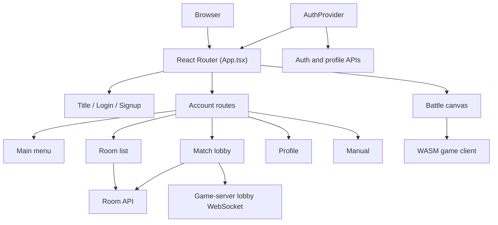
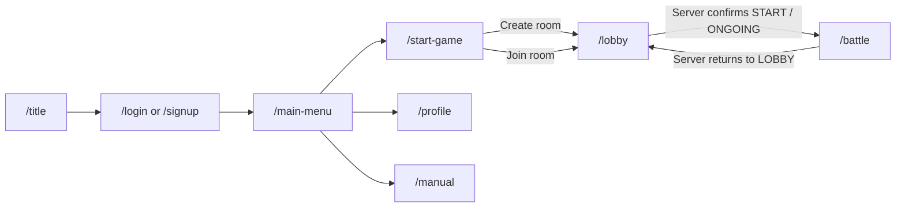
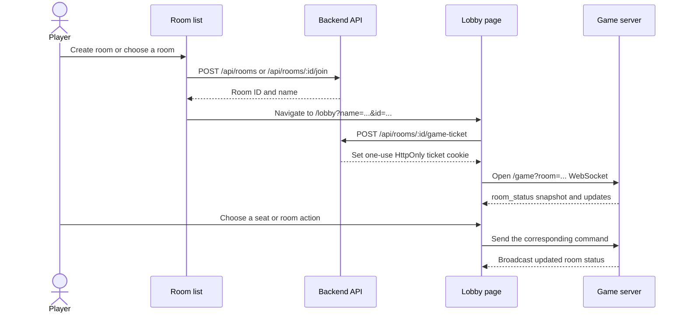
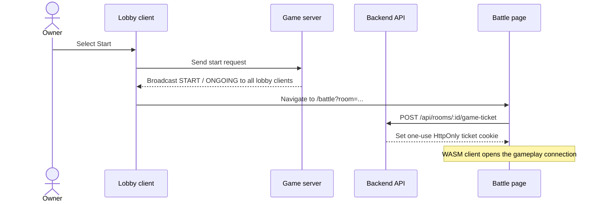

# Frontend
## Technology stack

This React and TypeScript single-page app, built with Vite, provides the account, room, and lobby experience along with the in-game interface. The C++ game client runs separately in WebAssembly and handles gameplay and rendering, while React manages the surrounding UI.

| Technology | Role in this frontend |
| --- | --- |
| **React** and **React DOM** | Build the interface from components and mount it in the browser. `main.tsx` sets up the root of the app. |
| **TypeScript** | Adds static types to components, browser APIs, account and API data, and WebSocket messages. The `build` script runs `tsc -b` before bundling, so type errors can be caught before a production build. |
| **Vite** | Runs the local development server and bundles the app for production. `vite.config.ts` enables React and Tailwind, maps `@/` to `src/`, and proxies local API and game WebSocket requests. |
| **React Router** | Maps URL paths to page components, handles client-side navigation, and supports the guest/account route guards. |
| **Tailwind CSS** | Provides utility classes for styling; its Vite plugin integrates it into development and production builds. |
| **Gamify**, **NyxUI**, **Bwo UI** | Supply reusable interface elements such as cards, buttons, inputs, avatars, and checkboxes. |
| **Lucide React** and **Motion** | Provide icons and animation used by interface components. |

The application imports code and styles from dependencies as ES modules. Local imports split the app into pages, reusable components, authentication, and API helpers; CSS imports load global and library styles. Vite resolves these imports, applies the configured alias and plugins, and bundles the browser-ready output. The generated `src/wasm/client.js` and `client.wasm` are not React modules: they are the Emscripten output for the C++ client, loaded by `bootEngine.ts` when the battle page starts.

## Frontend structure

| Path | Responsibility |
| --- | --- |
| `src/main.tsx` | Mounts the app inside the router and shared authentication provider |
| `src/App.tsx` | Routes and account/guest route guards |
| `src/auth/` | Shared authentication state and hooks |
| `src/pages/` | Route-level screens |
| `src/components/` | Reusable UI, room slots, HUD, and game overlays |
| `src/lib/` | Auth, profile, and room HTTP APIs |
| `src/bootEngine.ts`, `src/wasm/` | WASM game startup and generated client |
| `public/assets/` | Runtime game assets |

## App map

`main.tsx` mounts the app inside `BrowserRouter` and `AuthProvider`. The provider restores and refreshes the current session, shares authentication changes between tabs, and exposes account/profile actions to pages. `App.tsx` selects the page for the current route and applies the route guards. Login and signup routes are guest-only; the menu, room, lobby, battle, profile, and manual routes require an account. The title route is public.

## Page and match flows

### 1. Pages and navigation

| Route | Page | Access | Purpose |
| --- | --- | --- | --- |
| `/title` | Title | Public | Entry screen with links to sign in or register |
| `/login`, `/signup` | Authentication | Guests only | Sign in or create an account |
| `/main-menu` | Main menu | Account required | Navigate to rooms, profile, or manual |
| `/start-game` | Room list | Account required | Browse, create, or join rooms |
| `/lobby` | Match lobby | Account required | View players and spectators, choose a seat, and start a match as owner |
| `/battle` | Game | Account required | Play in the WebAssembly client with the HUD and match overlays |
| `/profile` | Profile | Account required | Update account details, avatar, and username |
| `/manual` | Manual | Account required | Read game rules and controls |

The title page leads guests to login or signup. Successful authentication leads into the main menu, from which a player can open the room list, profile, or manual. The remaining pages support the multiplayer match flow described below.

### 2. Account and information pages

- **Title, login, and signup:** The title page offers the guest entry points. Login and signup are guest-only routes; once a session is established, the guest guard redirects an authenticated user to the main menu.
- **Main menu:** The authenticated navigation hub links to the room list, profile, and manual.
- **Profile:** The page displays the current account and lets the user change their avatar or username, or log out.
- **Manual:** The page explains the match rules and controls, including movement, jumping, mouse camera control, and releasing the mouse.

### 3. Room list

The room list loads from the backend on entry, refreshes every five seconds, and refreshes when the tab becomes visible. Creating a room or joining a listed room uses the room API; private rooms prompt for a password. Both actions return a room ID used to open the lobby. The creator also receives a one-time navigation flag so the lobby can claim the initial owner seat.

### 4. Match lobby

After the room API accepts the create or join request, the lobby requests a short-lived, one-use ticket before opening its WebSocket. The ticket is sent as an HttpOnly cookie, rather than in the WebSocket URL.

The action depends on the player's role:

- **Room creator:** on WebSocket connection, automatically claims blue-1, the owner seat.
- **Player:** starts as a spectator and can send a `join` command to claim an empty seat.
- **Room owner:** can send `set_cpu` for an empty seat or `clear_seat` for an occupied seat. The owner cannot clear blue-1.

The game server is authoritative: the lobby displays the roster and spectator count from `room_status` messages and updates only after the server broadcasts a change. Status revisions let the client ignore stale updates. The server validates each command, so a rejected action does not change the displayed roster.

**_START A MATCH_**

Starting is an owner action, but the resulting state change is broadcast to everyone in the lobby. Each connected client navigates to the game page, which obtains its own ticket before starting the game engine.

The server decides whether a start request is valid; the frontend waits for its broadcast rather than treating the click as confirmation. The lobby obtains a ticket for its own WebSocket, and the battle page obtains a separate fresh ticket for gameplay. The lobby WebSocket closes when the lobby unmounts; gameplay uses the separate WebSocket opened by the WASM client.

### 5. Battle page

`/battle` obtains a fresh one-use game ticket before starting the WASM engine - required on every page load, including refreshes. `bootEngine.ts` fetches the game's shaders, models, textures, and audio assets, places them in the WASM virtual filesystem, and starts the generated C++ client. The client owns its gameplay connection. The result is displayed for 10 seconds while the match is in the END state, after which clients are automatically redirected to the lobby.

## From route to game client

1. `main.tsx` mounts the app inside `BrowserRouter` and `AuthProvider`. The provider makes shared session state and account actions available to pages.
2. `App.tsx` selects the page for the current route and applies the guest-only or account-required guards.
3. During a match, `/battle` requests a one-use ticket. `bootEngine.ts` fetches the runtime shaders, models, textures, and audio, then writes them to the Emscripten virtual filesystem.
4. The generated JavaScript loader initializes the WebAssembly module and connects it to the page's canvas. The C++ client handles game rendering and gameplay networking.
5. React remains responsible for browser UI around the canvas. The game client reports match state, timer, and score through browser callbacks; the battle page uses those updates to render the HUD, countdown, and result overlay.

